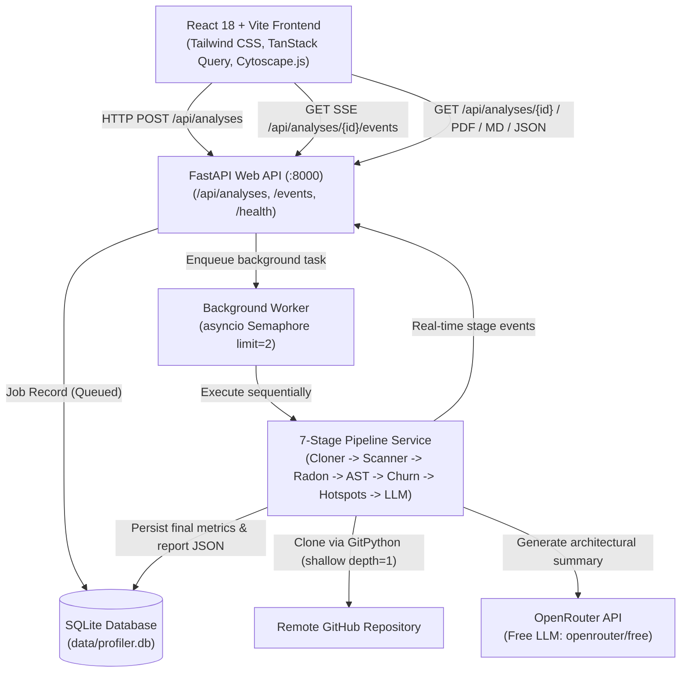
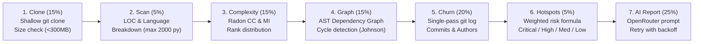
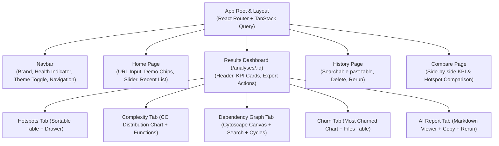

# System Architecture & Data Flow

This document details the architectural layout, data pipeline stages, and end-to-end communication pathways of the **GitHub Repo Complexity Profiler**.

---

## 1. High-Level Architecture Overview

---

## 2. 7-Stage Analysis Pipeline & Progress Weights

Each stage computes domain-specific metrics and emits progress over Server-Sent Events (SSE). Cloned repositories are strictly cleaned up in a `finally` block with Windows-safe permissions.

### Stage Weights & Output Summary

| Stage | Weight | Cumulative % | Core Operation | Fault Tolerance Policy |
|---|---|---|---|---|
| **1. Clone** | 15% | 15% | `git clone --depth 1` into temp dir; check repo size. | Fails job if repo is private, invalid, or > 300MB. |
| **2. Scan** | 5% | 20% | Recursive directory walk; count LOC; detect Python files. | Caps files at 2000; returns empty Python notice if 0 py files. |
| **3. Complexity** | 15% | 35% | Radon Cyclomatic Complexity (CC) and Maintainability Index (MI). | Per-file try/except prevents single syntax error from failing job. |
| **4. Graph** | 15% | 50% | AST import parsing, module nodes, edge dependencies, circular cycles. | Ignores syntax errors; returns empty graph if no imports found. |
| **5. Churn** | 20% | 70% | Single-pass `git log --name-only` streaming parser. | Falls back to empty churn if git log fails or repo has 1 commit. |
| **6. Hotspots** | 5% | 75% | Risk score formula: `0.5*churn + 0.3*CC + 0.2*(1-MI/100)`. | Guarded with divide-by-zero protection. |
| **7. AI Report** | 25% | 100% | Structured prompt sent to OpenRouter free LLM with exponential backoff. | If LLM fails after 2 retries, status is marked `report_status="failed"` without discarding metrics. |

---

## 3. Hotspot Risk Math

The risk score of any Python file $i$ is evaluated on normalized intervals $[0, 1]$:

$$\text{Risk}(i) = 0.50 \cdot \overline{\text{Churn}}(i) + 0.30 \cdot \overline{\text{CC}}(i) + 0.20 \cdot \overline{\text{InvMI}}(i)$$

Where:
- $\overline{\text{Churn}}(i) = \frac{\text{Commits}(i)}{\max(\text{Commits})}$
- $\overline{\text{CC}}(i) = \frac{\text{MaxCC}(i)}{\max(\text{MaxCC})}$
- $\overline{\text{InvMI}}(i) = \frac{100 - \text{MI}(i)}{100}$

### Risk Tiers
- **🔴 Critical:** $\text{Risk} \ge 0.70$
- **🟠 High:** $0.50 \le \text{Risk} < 0.70$
- **🟡 Medium:** $0.30 \le \text{Risk} < 0.50$
- **🟢 Low:** $\text{Risk} < 0.30$

---

## 4. Frontend Component & Page Architecture

